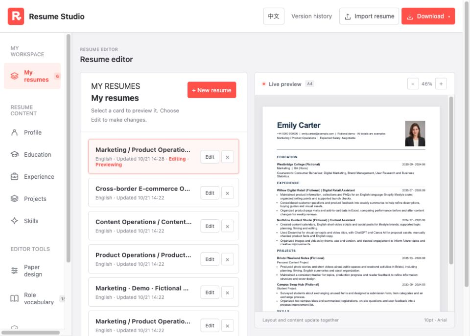
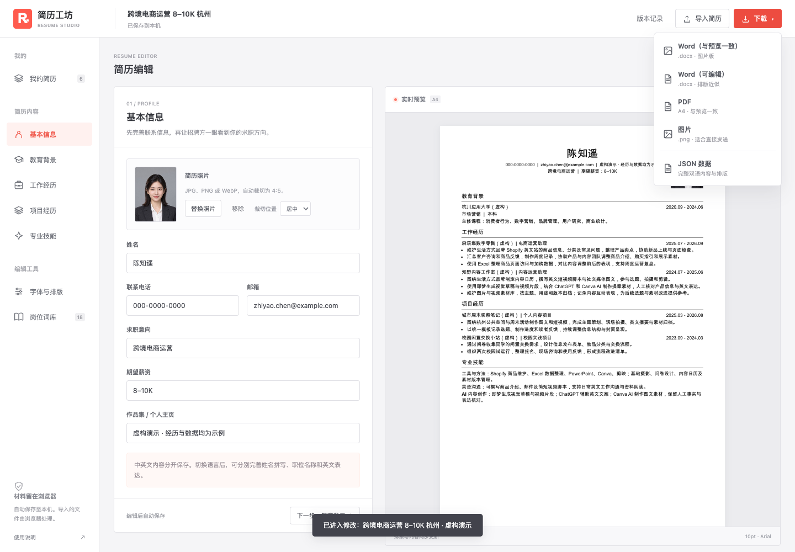

# 简历工坊 · Resume Studio

[**中文**](README.md) | [English](README.en.md)


[](https://github.com/Tantantan-lab/resume-studio/actions/workflows/ci.yml)
[](https://tantantan-lab.github.io/resume-studio/)

一个**本地优先**的中英双语简历编辑器：A4 实时预览、多份简历库、按岗位/薪资/地区命名、照片同步，以及和预览一致的 Word / PDF / PNG 导出。

在线演示：**https://tantantan-lab.github.io/resume-studio/**

<p align="center">
  
  
</p>

> 这是 MVP 版本：纯静态前端，无后端、无账号、无上传；AI 协作由**本地 MCP Server / Agent 工作流**完成（Codex / Claude / DeepSeek 读取聊天记录 → 模板 + JSON → 校验导入）。

## 功能

- **我的简历**：多版本简历库，按「岗位 + 薪资 + 地区」命名，点击预览、点「修改」进入编辑
- **双语展示**：默认中文界面与陈知遥虚构中文简历，英文界面与 Emily Carter 虚构英文简历分别切换
- **中英双语**：中英文内容独立保存，一键切换
- **导入**：JSON、Word (.docx)、PDF（文字版）、TXT、Markdown；Word/PDF 导入后需核对识别结果
- **纸面设计**：经典单栏、海外简洁、现代侧栏、编辑式；主题色与照片显示可调
- **自动铺满一页**：只扩展模块、条目与段落间距，保持字号；超一页时不压缩正文
- **实时 A4 预览**：字体、字号、行距、页边距可调
- **期望薪资**：求职意向 + 薪资显示在预览、Word、PDF、PNG 中
- **照片同步**：上传一次，同步到所有简历版本和双语档案
- **下载**：
  - `Word（与预览一致）`：图片版 DOCX，视觉完全一致
  - `Word（可编辑）`：文字可编辑，排版近似
  - `PDF（图片版）`：直接生成，与预览一致，无需打印窗口
  - `PDF（文字版）`：打开打印窗口另存，文字可选中、搜索、复制
  - `PNG`：与预览一致
  - `JSON`：完整双语数据与排版，可跨设备导入
- **项目时间排序**：项目按结束时间倒序，未填日期放最后
- **本地 Agent**：让本地 Codex / Claude / DeepSeek 根据历史聊天生成简历 JSON，经校验后导入（见下文）

## 快速开始

要求：Node.js 20.19+（或 22.12+）

```bash
npm install
npm run dev
# 打开 http://127.0.0.1:4173
```

端口被占用时，可运行 `npm run dev -- --port 4180`。

构建与预览：

```bash
npm run build
npm run preview
```

检查与测试：

```bash
npm run check          # 检查源码、脚本和测试的 JS 语法
npm run format:check   # 检查统一代码格式
npm run lint           # ESLint
npm run format         # 格式化自有代码，排除 vendor、private 和 dist
npm run test:unit      # 本地服务与演示头像回归检查
npm run verify         # 格式、语法、单元检查及浏览器导出测试
npm test               # 构建 + Playwright 冒烟测试（使用本机 Chrome，可用 CHROME_PATH 指定）
```

> 测试需要本机安装 Chrome/Chromium；不会下载浏览器。浏览器测试会实际下载五种格式并触发文字版 PDF 打印，校验文件名、照片媒体和文件结构，结束后清理测试文件。

## 目录结构

```
.
├── src/                 # 应用源码（静态站点）
│   ├── index.html
│   ├── app.js           # 启动与事件接线（约 86 行）
│   ├── io.js            # JSON/DOCX 导入导出、图片版 Word/PDF
│   ├── demo/            # 虚构演示数据、岗位变体与头像
│   ├── lib/             # store、迁移、编辑器、简历库、预览、照片、版本、导入、下载
│   ├── terms.js         # 岗位词库
│   ├── styles.css
│   └── public/          # favicon 与 vendor/{docx,jszip,pdf-lib}.js
├── vite.config.js       # Vite：root=src、base=./、outDir=dist
├── scripts/
│   ├── serve.mjs        # 预览/测试用静态服务器（dist）
│   ├── agent.mjs        # 本地 Agent CLI（导出/提示词/校验/应用）
│   └── agent-server.mjs # 可选的本地 Agent HTTP API
├── templates/           # 岗位模板（MCP list_templates/get_template）
├── .mcp.json            # Claude Code 项目级 MCP 配置
├── tests/smoke.mjs      # Playwright 冒烟测试
├── docs/                # 架构、数据模型、提示词、部署、隐私
├── private/             # 个人简历 JSON / 研究数据（已 gitignore，不提交）
└── dist/                # 构建产物（已 gitignore）
```

## 本地 Agent：用历史聊天写简历

适用于本地 Codex、Claude、DeepSeek 等编码 Agent。核心原则：**Agent 只基于聊天里真实出现的事实写简历，不编经历、不编数字**。

```bash
# 1) 准备一份“当前简历”作为底稿（可从应用导出 JSON 放到 private/resume.json）
node scripts/agent.mjs export --out private/agent/current.json

# 2) 把你的历史聊天整理成一个文本文件，生成 Agent 提示词
node scripts/agent.mjs prompt --history private/chat.md --resume private/agent/current.json

# 3) 把 private/agent/prompt.md 交给本地 Codex / Claude / DeepSeek，
#    让它只输出一个 candidate JSON

# 4) 校验并生成可导入文件
node scripts/agent.mjs apply private/agent/candidate.json
# 输出：private/agent/resume-import.json

# 5) 在页面「导入简历」选择该 JSON（导入前会自动备份）
```

也可以启动本地 API，让 Agent 直接写入：

```bash
node scripts/agent-server.mjs   # http://127.0.0.1:4178
curl http://127.0.0.1:4178/api/health
curl -X POST http://127.0.0.1:4178/api/resume \
  -H 'Content-Type: application/json' \
  --data @private/agent/candidate.json
```

详细规则见 [AGENTS.md](AGENTS.md)、[docs/PROMPTS.md](docs/PROMPTS.md)、[docs/AGENT_API.md](docs/AGENT_API.md)。示例聊天见 [examples/chat.md](examples/chat.md)。

## MCP Server：AI 自动发现工具

仓库包含本地 stdio MCP Server（`.mcp.json` + `scripts/mcp-server.mjs`）。Claude Code 打开项目后会自动发现；Codex 可通过 MCP 配置或 `codex mcp add` 接入。

工具：`list_templates`、`get_template`、`create_resume`、`update_resume`、`list_resumes`、`get_resume`、`get_instructions`。

模板在 `templates/`：市场营销 / 产品运营、跨境电商运营、内容运营、产品运营、英文海外市场营销。AI 选模板后用聊天记录里的真实事实写 JSON，`create_resume` 输出可导入文件。

```bash
npm run mcp   # stdio server；通常由 MCP 客户端拉起
```

详细配置和流程见 [docs/MCP.md](docs/MCP.md)。

## 演示数据

演示头像为 AI 生成的虚构人物，已包含在默认中英文资料中。旧演示内容迁移需要中英文旧演示姓名与邮箱同时匹配；只替换对应演示档案和演示快照，保留其他身份、现有照片与版式。岗位词库已移除个人经历依据，使用前需按本人材料确认。

`src/demo/data.js` 是**全新虚构演示数据**：中文档案为陈知遥（zhiyao.chen@example.com），英文档案为 Emily Carter（emily.carter@example.com），人物、院校、公司、项目和经历均独立编写，不沿用个人简历。五个岗位演示与两种语言共用这套背景，并在预览和导出中保留虚构标记。演示迁移仅匹配演示姓名和邮箱，不改写个人档案。你的真实简历请放在 `private/`（已忽略）或在页面里导入，不要提交到公开仓库。

## 隐私

> GitHub Pages 的项目站点共享 `https://<user>.github.io` 源，`localStorage` 与同账号其他 Pages 项目共享。公开演示请只使用虚构数据；真实简历请用本地 4173 版本或专用域名。

- 所有内容保存在浏览器 `localStorage`，不经过服务器
- 没有账号、没有埋点、没有上传
- 照片/联系方式只存在本机；清除站点数据会删除
- 图片版 Word/PDF 与本机预览一致，但文字不可编辑；可编辑 Word 排版为近似值

## 部署

本项目是纯静态站点：

```bash
npm run build
# 将 dist/ 部署到 GitHub Pages / Netlify / Vercel / 任意静态托管
```

已附带 GitHub Pages 工作流（`.github/workflows/pages.yml`）。注意 `localStorage` 按域名隔离，换域名后需要重新导入 JSON。

首次发布到 GitHub：

```bash
git init
git add .
git commit -m "feat: resume studio MVP"
git branch -M main
git remote add origin git@github.com:<you>/resume-studio.git
git push -u origin main
```

`private/`、`dist/`、`node_modules/` 已被 `.gitignore` 忽略。Vite 构建后 `dist/index.html` 引用 `./assets/index-<hash>.js|css` 和 `./vendor/*.js`，可直接部署到任意子路径。

## 文档

- [架构](docs/ARCHITECTURE.md)
- [数据模型](docs/DATA_MODEL.md)
- [修改指南（人 + 提示词）](docs/PROMPTS.md)
- [本地 Agent API / CLI](docs/AGENT_API.md)
- [MCP Server](docs/MCP.md)
- [自定义](docs/CUSTOMIZE.md)
- [部署](docs/DEPLOY.md)
- [隐私](docs/PRIVACY.md)

## Roadmap

- [x] 抽出共享 schema、视觉导出、下载与简历命名工具
- [x] 把 `src/app.js` 拆成 store / migrations / library / editor / preview / photo / versions / import / download 模块
- [ ] Agent 更新后的页面自动同步（目前用导入 JSON）
- [ ] AI 编辑框（可选联网模型；默认保持本地）
- [ ] 更多 A4 模板与中文字体预设
- [ ] 单元测试覆盖导入校验与库切换

## License

[MIT](LICENSE) · 第三方依赖见 [ACKNOWLEDGEMENTS.md](ACKNOWLEDGEMENTS.md)

纸面设置、自动填页和英文界面说明见 [docs/PAPER_DESIGN.md](docs/PAPER_DESIGN.md)。
